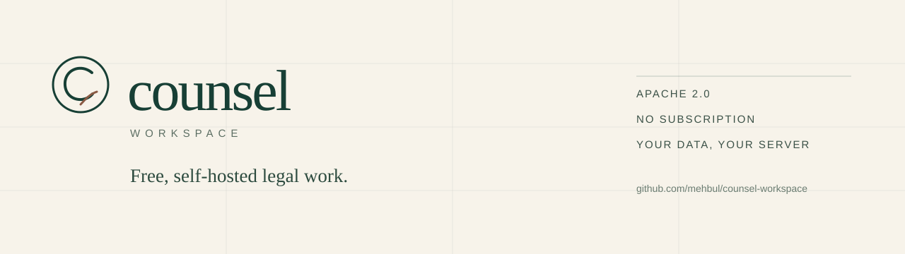
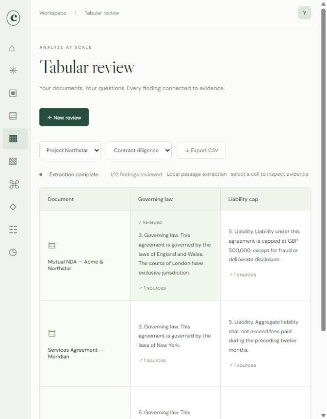
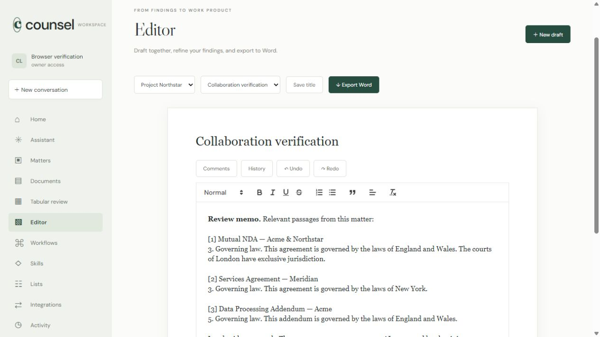
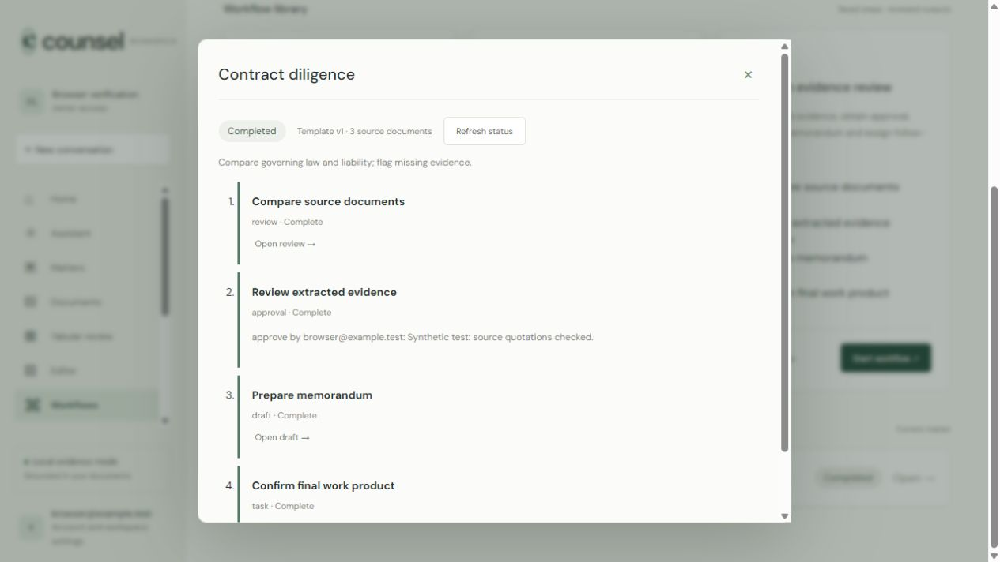

<p align="center">
  
</p>

# Counsel workspace

**A free, self-hosted legal workspace for contract review, legal research,
drafting, workflows and client collaboration.** Run it on your own computer or
server. No Legora subscription, per-seat fee, telemetry, or mandatory model API.

[](https://github.com/mehbul/counsel-workspace/actions/workflows/ci.yml)
[](https://github.com/mehbul/counsel-workspace/actions/workflows/codeql.yml)
[](LICENSE)
[](package.json)

[Quickstart](#quickstart) · [Features](#what-it-does) · [Screenshots](#screenshots) · [How it compares](#how-it-compares) · [Documentation](docs/) · [Website](https://mehbul.github.io/counsel-workspace/)

> **0.2 public preview.** Useful and tested, but not independently audited, not
> legal advice, and not a claim of legal accuracy or Legora equivalence. Read the
> [disclaimer](DISCLAIMER.md), [security policy](SECURITY.md), and
> [known limits](#what-it-does-not-do) before putting client material in it.

## Why this exists

Legal AI is increasingly sold per seat to firms with enterprise budgets. Solo
lawyers, small practices, legal-aid teams, researchers, and people in
lower-resource jurisdictions are often priced out, even when they handle the
same contracts and research questions.

Counsel is a serious, inspectable alternative for those users. It runs on a
laptop or a small server, keeps matter data under your control, works with local
or bring-your-own models, and exports a portable, checksummed matter archive.
The source is public under the Apache License 2.0, so you can verify what it
does, fix it, or extend it.

- **Free and open source.** Apache 2.0, no per-seat fee, no hosted account.
- **Self-hosted and private by default.** No telemetry. Model generation is off
  until you configure a provider.
- **Portable.** Owner/editor matter archives include a manifest, per-file
  SHA-256 checksums, readable source text, structured records, and an offline
  verifier. Originals are optional.
- **Assistant-native.** Connect Codex, Claude Code, or another MCP host with
  scoped, expiring, revocable keys.
- **Honest about scope.** The project publishes its tests, synthetic benchmarks,
  document-disjoint CUAD results, and missing enterprise features. It does not
  claim parity with a commercial platform.

## Screenshots

| Tabular review                                                                                 | Editor                                                                               |
| ---------------------------------------------------------------------------------------------- | ------------------------------------------------------------------------------------ |
|  |  |



Screenshots use synthetic seed data.

## Quickstart

### Personal mode (one computer)

Requires Node.js 24.15 or newer.

```sh
git clone https://github.com/mehbul/counsel-workspace.git
cd counsel-workspace
npm ci
npm run start:personal
```

Open <http://127.0.0.1:3000>. Personal mode opens directly with no app login and
keeps its SQLite data in `data/personal/workspace.db`. It accepts same-origin
loopback requests only and is intended for one trusted computer and
operating-system account.

### Team mode with Docker

```sh
cp .env.example .env
# Set DOMAIN and, if needed, a model provider.
docker compose --env-file .env up -d --build
```

On first run, use the one-time token in `data/bootstrap-token` to create the
owner account. Put the app behind HTTPS. Tagged releases also publish a
container image at `ghcr.io/mehbul/counsel-workspace`.

See [HTTPS deployment](docs/DEPLOYMENT.md) for the end-to-end TLS recipe and
[deployment and operations](docs/OPERATIONS.md) for members, matter grants,
backup/restore, and release gates.

### Native team mode

```sh
npm ci
npm start
```

The server listens on port 3000 by default. Set `APP_ORIGIN`, `COOKIE_SECURE`,
and the other variables in [`.env.example`](.env.example) before exposing it.

### Optional model generation

The default `AI_PROVIDER=evidence` makes no model calls. For local generation,
install [Ollama](https://ollama.com), pull a model, and set:

```sh
AI_PROVIDER=ollama
OLLAMA_MODEL=your-installed-model
OLLAMA_BASE_URL=http://127.0.0.1:11434
```

For an OpenAI-compatible endpoint, set `AI_PROVIDER=openai-compatible`,
`AI_BASE_URL`, `AI_MODEL`, and `AI_API_KEY`. For the native OpenAI path, set
`AI_PROVIDER=openai` and `OPENAI_API_KEY`. For Anthropic's Claude models, set
`AI_PROVIDER=anthropic` and `ANTHROPIC_API_KEY` (optional `ANTHROPIC_MODEL`,
default `claude-sonnet-4-6`). Owners can also save provider profiles in the
app's model settings; credentials are encrypted at rest. A subscription login
such as ChatGPT Plus or Claude Pro is used directly when you connect the
assistant through MCP (see below); in-app generation uses provider API keys,
which are billed separately by the provider. Cloud providers receive the
question and retrieved passages and may charge for use. See
[assistant and model setup](docs/ASSISTANTS.md).

## What it does

| Area                         | What you get                                                                                                                                                                                                                             |
| ---------------------------- | ---------------------------------------------------------------------------------------------------------------------------------------------------------------------------------------------------------------------------------------- |
| **Matters and documents**    | Persistent matters, PDF/DOCX/TXT/MD/CSV import, original-file retention, page and paragraph anchors, optional local OCR, search, and deletion.                                                                                           |
| **Review at scale**          | Ranked passage search, deterministic clause anchors, optional semantic candidates, conservative abstention, review tables, evidence inspection, editable findings, locks, status, filtering, sorting, pagination, and CSV export.        |
| **Comparisons and redlines** | Persisted document comparisons, source coverage, highlighted changes, CSV export, DOCX revision export, and tracked insertions through the Office bridge.                                                                                |
| **Drafting**                 | Rich-text editor, comments, checkpoints, proposed edits with accept/reject, source citations, and real DOCX export.                                                                                                                      |
| **Workflows**                | Versioned templates, ordered steps, selected sources, durable runs, approval gates with independent approvers and quorum, retries, cancellation, and schedules.                                                                          |
| **Client portal**            | Separate guest accounts, explicit document and reviewed-text publication, selected recipients, matter grants, and immediate revocation.                                                                                                  |
| **Research**                 | US Federal Register and eCFR imports with official-origin pinning, bounded requests, matter-scoped publication watches, deduplicated alerts, and source provenance.                                                                      |
| **Notifications**            | Owner-only encrypted channels for signed webhooks, Slack, and Microsoft Teams; workflow and monitor events; durable retries and receipts.                                                                                                |
| **Matter archives**          | Portable ZIP exports with `manifest.json`, `SHA256SUMS`, readable source text, structured records, a capped owner audit subset, optional retained originals, and an owner-only restore endpoint with an explicit no-side-effects policy. |
| **Assistants**               | MCP tools for scoped evidence reading and host-authored drafts, review tables, and tasks, with expiring and revocable keys.                                                                                                              |
| **Deployment**               | Personal mode, native team mode, Docker Compose, hardened-container checks, online backup, and restore guidance.                                                                                                                         |

Evidence-only mode uses deterministic clause-level anchors, metadata extraction,
BM25-style passage ranking, legal-concept aliases, document diversity, exact
source offsets, and conservative abstention. It does not invent a model answer.
Connected assistants can reason over the same sources and save their own
unreviewed analyses; Counsel itself does not call a model unless you enable one.

## Matter archives

An owner or editor can export a matter from the Documents page. The archive
contains:

```text
README.txt
manifest.json
SHA256SUMS
matter/*.json
documents/*.txt
drafts/*.txt
originals/*        (optional)
```

Verify it without extracting:

```sh
npm run verify:archive -- path/to/counsel-matter.zip
```

The verifier checks the ZIP structure and bounds, required files, checksum
coverage, manifest sizes and hashes, counts, the matter ID, and the payload
format. Archives are checksummed but **not encrypted, signed, or notarized**;
they are portable matter exports, not encrypted workspace backups.

A workspace owner can restore an archive as a new matter with
`POST /api/matters/archive/restore` (optionally `newIds=1`, which remaps all
record IDs when identifiers collide). Restores never resume execution: imported
jobs that were queued or running become `failed`, schedules and research watches
import disabled, workflow runs without a final status import as `cancelled`, and
former audit rows stay with the source workspace. Every one of these conversions
is reported in the restore response. See [Matter archives](docs/MATTER-ARCHIVE.md).

## How it compares

|                             | Counsel workspace                                             | Legora                                                |
| --------------------------- | ------------------------------------------------------------- | ----------------------------------------------------- |
| **Price**                   | Free, Apache 2.0                                              | Commercial subscription                               |
| **Hosting**                 | Your computer or server                                       | Vendor-hosted                                         |
| **Source**                  | Public and inspectable                                        | Proprietary                                           |
| **Data location**           | Your infrastructure                                           | Vendor infrastructure                                 |
| **Models**                  | Local Ollama, bring-your-own compatible API, or no generation | Vendor-managed                                        |
| **Enterprise integrations** | Limited connectors; iManage/NetDocuments not implemented      | Broader DMS, Word, and enterprise integration surface |
| **Support**                 | Community, best effort                                        | Commercial support                                    |
| **Scope**                   | Smaller, 0.1, single-instance                                 | Broader commercial platform                           |

This table is based on Legora's public materials as of October 2026. Features and
pricing change, and this is not a feature-by-feature audit. **No blinded
legal-quality comparison has been run.** If you need a supported enterprise
platform with mature DMS and tenant integrations, a commercial product may be the
right choice. If you need a free, private, inspectable workspace and can operate
it yourself, Counsel is for you.

## What it does not do

- Scanned PDFs support opt-in local Tesseract/Poppler OCR. See [OCR setup and limits](docs/OCR.md). Review recognized text against the original.
- No SSO, SCIM, MFA, or enterprise directory integration.
- No iManage or NetDocuments adapter, provider ACL sync, or ethical-wall mapping.
- No archive encryption, signature, or notarization. Restore is owner-only;
  restores never run jobs, re-enable schedules or watches, and never include
  audit rows.
- No multi-instance or high-availability mode.
- No independent security audit, penetration test, or legal review.
- No guarantee of legal accuracy. The clause engine's document-disjoint CUAD
  validation score is 33.98% answerable-only token F1 and 77.05% answerability
  balanced accuracy. The retrieval benchmark is synthetic and was designed
  alongside the implementation. These are regression measurements, not
  legal-quality evidence.
- No guarantee that a third-party model provider keeps data confidential.
- No legal advice, attorney-client relationship, or substitute for a lawyer.

Read [the verification and release status](docs/VERIFICATION.md) and
[the external legal evaluation](docs/LEGAL-EVALUATION.md) for the exact evidence
behind these statements.

## Security and trust

- Argon2 password hashing, revocable sessions, CSRF and origin checks, rate
  limits, and workspace/matter authorization.
- Owner, editor, viewer, and guest separation, with current grants rechecked
  before later workflow actions.
- Encrypted connector and notification secrets.
- SSRF-resistant outbound requests, upload parsing limits, and a dependency-free
  ZIP reader with path, duplicate, encryption, symlink, and checksum checks.
- GitHub CI builds the app, runs the test suite, audits dependencies, builds the
  Docker image, and smoke-tests a hardened container.
- CodeQL, Dependabot, dependency review, and a full-history secret scan are part
  of the public repository.

The project is a single-instance, self-hosted foundation. The operator is
responsible for TLS, host hardening, backups, account administration, and
compliance. See [SECURITY.md](SECURITY.md), [the threat model](docs/THREAT-MODEL.md),
and [PRIVACY.md](PRIVACY.md).

## Verify locally

```sh
npm test
npm run benchmark
npm run build
npm run format:check
npm run verify:archive -- path/to/archive.zip
```

Integration tests use isolated in-memory databases and temporary data
directories. They cover import, scoped citations, comparisons, reference checks,
source selection, extraction, locks, edits, collaboration, security regressions,
portal isolation, workflow approvals, notification delivery, archive access and
integrity, and DOCX export.

## Contributing

Contributions are welcome. Read [CONTRIBUTING.md](CONTRIBUTING.md) and the
[Code of Conduct](CODE_OF_CONDUCT.md). Security issues should be reported
privately through [GitHub Security Advisories](https://github.com/mehbul/counsel-workspace/security/advisories/new),
not in a public issue.

Good first areas: documentation, accessibility, synthetic test fixtures,
deployment guides, and small connector improvements. Large features should start
as an issue so scope and access-control impact can be reviewed.

## License

Apache License 2.0. See [LICENSE](LICENSE), [NOTICE](NOTICE), and
[third-party notices](THIRD-PARTY-NOTICES.md).

"Legora" is a trademark of its respective owner. Counsel workspace is an
independent project and is not affiliated with, endorsed by, or sponsored by
Legora or any other commercial legal-AI provider.

If this project is useful to you, star the repository so other small practices
can find it.
